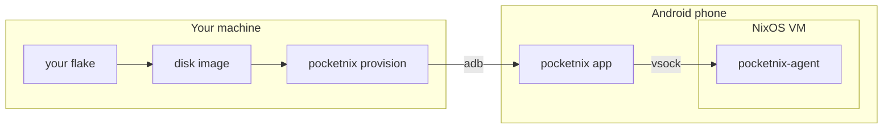

# pocketnix

Run NixOS on an Android phone as a real virtual machine, without root.

pocketnix boots a NixOS disk image under the Android Virtualization Framework
(AVF, pKVM) and gives you a terminal app for it. The guest is an ordinary
`nixosConfiguration` in your own flake, updated from your desktop or CI.

- An Android app that runs the VM in the background, with terminal tabs, extra
  keys, a command palette and a Quick Settings tile.
- A NixOS module that builds the bootable image and the guest agent.
- A CLI that provisions a phone over adb and injects secrets into the image.
- Integration with Android: notifications, `xdg-open`, the clipboard, the share
  sheet, the Files app, shared Android folders, and port forwards.
- Setup from the app: it downloads a NixOS image and configures it (user,
  services, packages), no Nix knowledge needed. Or provision your own flake.
- Updates and rollbacks from the app. Your own flake's updates arrive built.
- Optional Wayland apps shown as Android windows.

> [!WARNING]
> Early work. It is tested on one phone (Pixel 8 Pro, GrapheneOS, Android 17).
> Uninstalling the app deletes the VM's disk.



## Quick start

```bash
nix flake init -t github:nickolaj-jepsen/pocketnix
nix run github:nickolaj-jepsen/pocketnix#provision -- --image .#nixosConfigurations.phone
```

The template ([`templates/default`](templates/default)) is a guest named
`phone` with a user and ssh through a port forward. `provision` installs the release APK of its own version, or one you built
(`--debug --apk ...`). [Getting started](docs/getting-started.md) covers
building it, the requirements, ssh access and the first boot.

## Docs

- [Getting started](docs/getting-started.md): requirements, first install, first boot
- [Configuration](docs/configuration.md): the module, by topic
- [Options](docs/options.md): every module option, generated from the modules
- [Updates](docs/updates.md): build host, published path, rollback, recovery
- [GUI apps](docs/gui.md): Wayland apps as Android windows
- [Architecture](docs/architecture.md): how the pieces fit, and why
- [Development](docs/development.md): building, testing, releasing
- [GUI protocol](docs/gui-protocol.md): the compositor-to-app wire format

## License

GPL-3.0-or-later. Parts of the AVF engine are ported from
[Podroid](https://github.com/ExTV/Podroid) (GPL-2.0-or-later); the terminal
libraries come from [Termux](https://github.com/termux/termux-app) (Apache-2.0).
The guest compositor (`compositor/`) started from
[wprs](https://github.com/wayland-transpositor/wprs) and stays Apache-2.0
(see `compositor/LICENSE` and `compositor/NOTICE`). The app's zstd decoder
(`app/src/main/cpp/zstd`) is [Zstandard](https://github.com/facebook/zstd)'s,
under its BSD licence.
