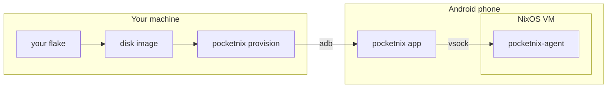

# pocketnix

Run NixOS on an Android phone as a real virtual machine, without root.

pocketnix boots a NixOS disk image under the Android Virtualization Framework
(AVF, pKVM) and gives you a terminal app for it. The guest is an ordinary
`nixosConfiguration` in your own flake, updated from your desktop or CI.

- An Android app that runs the VM in the background, with terminal tabs, extra
  keys, a command palette and a Quick Settings tile.
- A NixOS module that builds the bootable image and the guest agent.
- A CLI that provisions a phone over adb and injects secrets into the image.
- Integration with Android: notifications, `xdg-open`, the clipboard, the share
  sheet, the Files app, shared Android folders, and port forwards.
- Updates and rollbacks from the app. The phone never evaluates or builds Nix.
- Optional Wayland apps shown as Android windows.

> [!WARNING]
> Early work. It is tested on one phone (Pixel 8 Pro, GrapheneOS, Android 17).
> Uninstalling the app deletes the VM's disk.



## Quick start

```nix
# flake.nix
{
  inputs.nixpkgs.url = "github:nixos/nixpkgs/nixos-26.05";
  inputs.pocketnix.url = "github:nickolaj-jepsen/pocketnix";

  outputs = {nixpkgs, pocketnix, ...}: {
    nixosConfigurations.phone = nixpkgs.lib.nixosSystem {
      modules = [
        pocketnix.nixosModules.default
        {
          nixpkgs.hostPlatform = "aarch64-linux";
          pocketnix.guest.enable = true;
          system.stateVersion = "26.05";
        }
      ];
    };
  };
}
```

```bash
nix run github:nickolaj-jepsen/pocketnix#provision -- --image .#nixosConfigurations.phone
```

No release APK is published yet, so for now `provision` needs one you built
(`--debug --apk ...`). [Getting started](docs/getting-started.md) covers that,
the requirements, ssh access and the first boot.

## Docs

- [Getting started](docs/getting-started.md): requirements, first install, first boot
- [Configuration](docs/configuration.md): the module, by topic
- [Updates](docs/updates.md): build host, published path, rollback, recovery
- [GUI apps](docs/gui.md): Wayland apps as Android windows
- [Architecture](docs/architecture.md): how the pieces fit, and why
- [Development](docs/development.md): building, testing, releasing
- [GUI protocol](docs/gui-protocol.md): the compositor-to-app wire format

## License

GPL-3.0-or-later. Parts of the AVF engine are ported from
[Podroid](https://github.com/ExTV/Podroid) (GPL-2.0-or-later); the terminal
libraries come from [Termux](https://github.com/termux/termux-app) (Apache-2.0).
The guest compositor (`compositor/`) started from
[wprs](https://github.com/wayland-transpositor/wprs) and stays Apache-2.0
(see `compositor/LICENSE` and `compositor/NOTICE`). The app's zstd decoder
(`app/src/main/cpp/zstd`) is [Zstandard](https://github.com/facebook/zstd)'s,
under its BSD licence.
