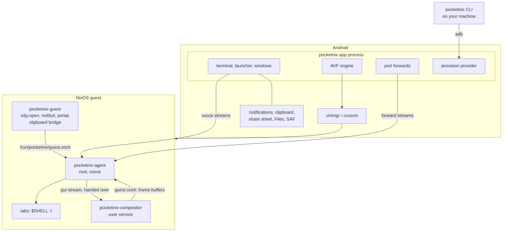
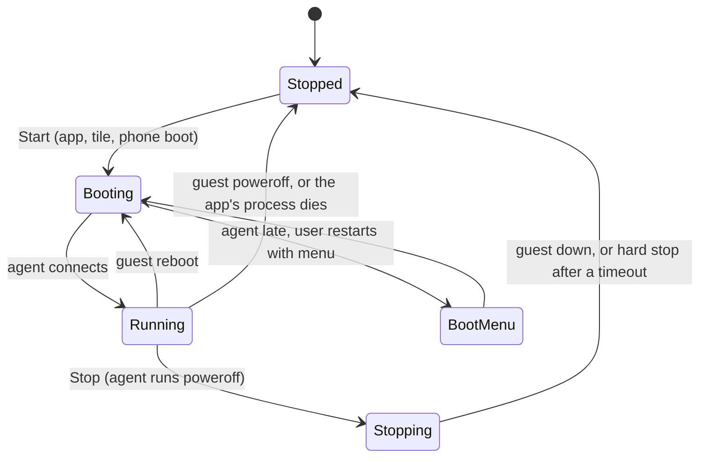

# Architecture

## Pieces

| Directory | What |
|---|---|
| `app/` | The Android app (Kotlin, Compose). AVF through reflection, since the API is `@SystemApi`. |
| `terminal-emulator/`, `terminal-view/` | Termux's terminal libraries, vendored and changed to run over a stream instead of a local subprocess. |
| `go/` | One Go module: `pocketnix-agent` (guest), `pocketnix-guest` (guest-side CLI), `pocketnix` (host CLI), sharing `internal/protocol`. |
| `compositor/` | The guest's Wayland compositor (Rust, Smithay, started from wprs). |
| `nix/` | The NixOS modules, packages, VM tests and devshell. |

## The agent link

- The app always dials; an AVF guest can't dial the app. The agent listens on
  vsock and admits only the host (CID 2).
- Every connection opens with the app's Hello naming a stream kind; the agent
  answers with its own Hello or an Error. Versions are negotiated there, so
  the app and the module may drift a little.

- Each job gets a stream of its own: one `control` stream (newline-delimited
  JSON: config, requests, events pushed by the guest), one `pty` stream per
  tab, one per forwarded connection or file operation, one per shared folder,
  one for the guest's sound, and the compositor's
  ([GUI protocol](gui-protocol.md)). The kinds are the `Stream*` constants in
  `go/internal/protocol`.
- A vsock stream carries about 110 MB/s on a phone, far short of full-screen
  frames at display rate. So the app makes the memory the guest runs on, and
  big frames cross as the addresses of the guest pages holding them (the GUI
  protocol's Guest RAM); the stream carries only the page lists.

- A tab needs nothing from the control stream, so a stuck control channel
  doesn't freeze terminals.
- The app pings a quiet control stream and drops one that stays silent, so a
  hung guest shows as "agent absent", never as running.
- Guest programs reach the agent on `/run/pocketnix/guest.sock`, which admits
  root and the session user by peer credentials. Requests can pass file
  descriptors, so the root agent never opens a path on a user's behalf. The
  compositor asks there for frame buffers: memory the agent pins in guest
  RAM and hands back as a memfd ([Guest RAM](gui-protocol.md#guest-ram)).

## The module owns the guest's contract

- Kernel: Google's prebuilt AVF guest kernel. Stock nixpkgs kernels corrupt
  virtio-blk reads under pKVM.
- Image: a repart raw disk (ESP and ext4 root); u-boot loads systemd-boot.
  First boot registers the store and grows the root.
- The agent's config is a JSON file the module writes. A switch reloads the
  agent with SIGHUP instead of restarting it: tabs are its children, and a
  switch usually runs in one.
- Tabs run as `pocketnix.guest.user` with credentials the agent switches
  itself (no PAM). Lingering gives them a user manager and session bus.

## VM lifecycle

- A foreground service keeps the app, and so the VM, alive. virtmgr ties the
  VM to the app's process.
- No wake lock unless the guest holds a logind inhibitor.
- The app reports the phone's state (`HostState` in `go/internal/protocol`)
  on connect and on changes, debounced. It belongs to the stream that
  sent it: without an app the guest is offline and on battery.

## Integrations

The agent can't dial the app, so anything the guest starts is an event on
the control stream, answered by streams the app opens carrying the event's
ref. With no app connected, a request fails instead of queueing.

- Notifications: `pocketnix-guest notifyd` is `org.freedesktop.Notifications`
  on the session bus. The agent assigns ids, so a replacement keeps its
  Android notification across a notifyd restart. Urgency picks the channel.
  Actions and dismissals come back over one long-lived `subscribe`
  connection.
- Clipboard: a guest copy sets Android's. Android only lets an app read the
  clipboard while focused, so the app sends it when it gains focus. Types
  other than text are lazy both ways: only the MIME types cross until a paste
  asks for the bytes. Wayland apps' selection is bridged by
  `pocketnix-guest clipboard`, which copies theirs out like any guest copy and
  takes Android's from a `subscribe-clipboard` connection. A password
  manager's copy stays marked sensitive on Android.
- File provider: a `DocumentsProvider` over `files.root`. Reads are ranged
  over one stream per open descriptor. Writes go to a temporary file beside
  the target, which the writer's close fsyncs and renames over it, so readers
  see the old file or the new one and a dropped stream discards the write.
- Shared folders: FUSE, since the guest kernel has no 9p and AVF's virtiofs
  isn't open to third-party VMs. The app keeps `hostfs` streams open per
  folder and answers file operations from `DocumentsContract`. Entries and
  attributes are cached briefly, as SAF listing is slow. A rename over a file
  deletes it first; moves need the provider's `moveDocument`, else EXDEV.
- Pick and save: they wait on the user, up to a time limit, and land files
  like shares. The FileChooser portal is built on them.
- Open and share from the background become a notification to tap, as
  Android won't start an activity then.

## Security boundaries

- Agent endpoints never leave the app process. Port forwards bind `127.0.0.1`
  unless a forward sets `lan = true`.
- Forward offers come only from the session user's listeners, and an allowed
  one binds `127.0.0.1` unless `forwardOffers.lan` is set. The agent splices a
  port the module doesn't forward only while the session user alone listens
  on it.
- The provision provider admits only the adb shell user.
- Paths the root agent opens for the user (history, the share directory, the
  file provider root) go through an `os.Root`: no path or symlink leaves them.
- Shared-folder mounts admit only the session user, not even root.
- `provision` pins the release signing certificate and refuses a downloaded
  APK signed by anyone else. A signature change would force an uninstall,
  which deletes the disk.
- The build-host user can only build its guest's pinned installable.

## Design rules

- The VM is cattle: it rebuilds from the flake and a cache. A managed guest's
  flake is the app's selections, which the app keeps, so a fresh disk rebuilds
  to the same system. Back up user state from inside the guest.
- Only a managed guest evaluates on the phone, under a CPU quota, and nothing
  compiles there unless the user says yes. Every other guest's updates arrive
  built ([Updates](updates.md)).
- Setup is either the first-run screen's one form (a managed guest from the
  release's base image) or `provision` (your own flake). The AVF permissions
  need adb once either way, since only the shell user can grant them.
- What changes with the system lives in the module and applies live; what
  must exist before boot, or only the phone knows, lives in the app.
  The exception is `pocketnix.guest.gpu.enable`, by choice: the GPU goes
  with the system that drives it, so the app keeps the last config's
  answer and gives the GPU from the VM's next start.
