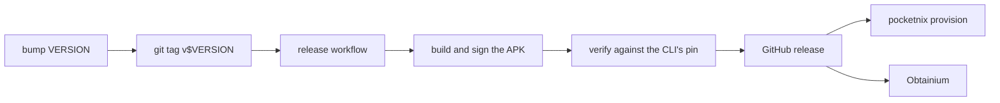

# Development

## Setup

```bash
nix develop   # the toolchains for everything below (x86_64-linux only)
```

The guest is `aarch64-linux`. On x86_64, building the example image needs
`boot.binfmt.emulatedSystems = ["aarch64-linux"]` or an aarch64 builder.

## Build

`./gradlew assembleDebug` builds `app/build/outputs/apk/debug/app-debug.apk`.
The flake's packages and apps (`nix flake show`) build the Go binaries and the
compositor, running their tests, and the example guest's disk image;
`nix run .#boot-example` boots that image under QEMU and prints the agent's
vsock address.

After changing `go/go.mod`, update `vendorHash` in `nix/go.nix`.

## Test

```bash
nix flake check                       # every check for this system (avf-boot on x86_64 needs aarch64 builds)
go -C go vet ./... && go -C go test ./...
./gradlew testDebugUnitTest
nix fmt .                             # alejandra; Go code is gofmt'ed
```

The checks are `checks` in `flake.nix`; each VM test's file under `nix/`
opens with what it covers, and the NixOS VM tests run on x86_64 only.

- The JVM tests also run against real binaries when given them:
  `POCKETNIX_AGENT=<...>/bin/pocketnix-agent` and
  `POCKETNIX_COMPOSITOR=<...>/bin/pocketnix-compositor` (with foot on PATH).

## Run the app without a phone

Debug builds can talk to an agent over TCP instead of booting a VM, so the UI
runs on the Android emulator against a desktop agent:

```bash
nix build .#pocketnix
./result/bin/pocketnix-agent --config agent.json --listen tcp:0.0.0.0:9100 --no-power
adb shell am start -n dev.nickolaj.pocketnix.debug/dev.nickolaj.pocketnix.ControlActivity \
  -a dev.nickolaj.pocketnix.action.START --es tcp 10.0.2.2:9100
```

`agent.json` is the file the module writes to `/etc/pocketnix/agent.json`;
copy one from a built guest. Never expose a TCP listener beyond a test: it
hands a shell to anyone who reaches it.

`pocketnix agent --connect <tcp:...|unix:...|vsock:<cid>:9100> <command>`
talks to an agent the way the app does (`pocketnix agent -h`).

## Scripted control

`ControlActivity` takes intents over adb (it needs the `DUMP` permission,
which the adb shell has). Send scripted actions there, never to
`MainActivity`, whose launch intent Android replays when it restores the
task.

The actions are `dev.nickolaj.pocketnix.action.START` and `STOP`, and in debug
builds `DEBUG_TAB` (open and type into a tab), `DEBUG_DUMP` (dump tabs to
logcat) and `DEBUG_LAUNCH` (launch a GUI app). Their extras are the `EXTRA_*`
constants in `ControlActivity`; `start` reads `START`'s and gates the
debug-only ones on `BuildConfig.DEBUG`.

With the phone locked, an activity started over adb is never laid out, and
logcat is the only way to see the app; the debug actions exist for that.

## Permissions by hand

`provision` grants these, per Android user; uninstalling loses them:

```bash
adb shell pm grant dev.nickolaj.pocketnix.debug android.permission.MANAGE_VIRTUAL_MACHINE
adb shell pm grant dev.nickolaj.pocketnix.debug android.permission.USE_CUSTOM_VIRTUAL_MACHINE
```

## Releasing



- `VERSION` sets the app's `versionName` and `versionCode` and the CLI's
  version. `provision` installs the release of its own version.
- The workflow refuses a tag that doesn't match `VERSION`.
- Secrets: `POCKETNIX_RELEASE_KEYSTORE` (base64 keystore),
  `POCKETNIX_RELEASE_STORE_PASSWORD`, `POCKETNIX_RELEASE_KEY_ALIAS`,
  `POCKETNIX_RELEASE_KEY_PASSWORD`.
- Keep one signing key forever. A new key forces an uninstall, which deletes
  every user's VM disk.

## Releasing from a fork

A fork signs with its own key, so `provision` needs to know it:

- `releaseCertSHA256` in `go/cmd/pocketnix/apksig.go`: the SHA-256 of your
  signing certificate (DER).
- `downloadRelease` in `go/cmd/pocketnix/provision.go`: your repo's release URL.
- Consider your own `applicationId` in `app/build.gradle.kts`, so your build
  and upstream's don't collide on a phone.

Without a release, `provision --apk <file>` installs any APK you built.

## Pitfalls

`AGENTS.md` lists traps verified on real hardware and on the desktop (pKVM
quirks, AVF reflection, adb transfer limits, NixOS test details). Read it
before touching the engine, the image or the module.
