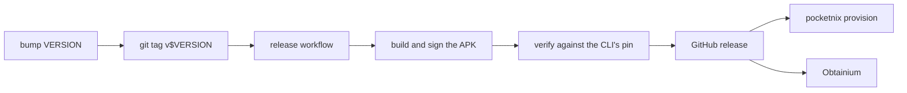

# Development

## Setup

```bash
nix develop   # the toolchains for everything below (x86_64-linux only)
```

The shell also puts this checkout's `pocketnix` on PATH, rebuilt from source
on each run.

The guest is `aarch64-linux`. On x86_64, building the example image needs
`boot.binfmt.emulatedSystems = ["aarch64-linux"]` or an aarch64 builder.
CI pushes what it builds to the `pocketnix` Cachix cache (`cachix use
pocketnix`), so a commit CI has built downloads its aarch64 agent, kernel and
compositor instead of emulating them; a guest whose nixpkgs differs from this
flake's builds its own.

## Build

`./gradlew assembleDebug` builds `app/build/outputs/apk/debug/app-debug.apk`.
The flake's packages and apps (`nix flake show`) build the Go binaries, the
compositor and the example guest's disk image (the tests are checks of their
own, so editing one doesn't rebuild the image);
`nix run .#boot-example` boots that image under QEMU and prints the agent's
vsock address.

After changing `go/go.mod`, update `vendorHash` in `nix/go.nix`. After
changing an option or bumping `flake.lock` (nixpkgs renders the doc), run
`nix run .#options-doc` to regenerate `docs/options.md`.

## Test

```bash
nix flake check                       # every check for this system (avf-boot on x86_64 needs aarch64 builds)
go -C go vet ./... && go -C go test ./...
nix run .#gradle -- testDebugUnitTest lintDebug
nix fmt                               # Nix, Go and Kotlin (nix/treefmt.nix)
```

The checks are `checks` in `flake.nix`; each VM test's file under `nix/`
opens with what it covers, and the NixOS VM tests run on x86_64 only.

- `nix run .#gradle` is `./gradlew` with the Android SDK and the real agent,
  compositor and foot, which the JVM integration tests opt into
  (`POCKETNIX_AGENT`, `POCKETNIX_COMPOSITOR`); plain `./gradlew` skips them.
- Lint fails on errors; `app/lint-baseline.xml` holds the warnings from
  before it ran in CI.
- A NixOS VM test runs interactively with
  `nix run .#checks.x86_64-linux.<test>.driverInteractive`.

## Run the app without a phone

Debug builds can talk to an agent over TCP instead of booting a VM, so the UI
runs on the Android emulator against a desktop agent:

```bash
nix run .#dev-agent
adb shell am start -n dev.nickolaj.pocketnix.debug/dev.nickolaj.pocketnix.ControlActivity \
  -a dev.nickolaj.pocketnix.action.START --es tcp 10.0.2.2:9100
```

`dev-agent` runs the example guest's agent config, evaluated for this
machine, with sessions as you; `POCKETNIX_PORT` moves it off 9100. It listens
on loopback, which the emulator reaches as 10.0.2.2. Never listen beyond
loopback outside a test: the agent hands a shell to anyone who reaches it.

`pocketnix agent --connect <tcp:...|unix:...|vsock:<cid>:9100> <command>`
talks to an agent the way the app does (`pocketnix agent -h`).

## Scripted control

`ControlActivity` takes intents over adb (it needs the `DUMP` permission,
which the adb shell has). Send scripted actions there, never to
`MainActivity` (see `AGENTS.md`).

The actions are `dev.nickolaj.pocketnix.action.START` and `STOP`, and in debug
builds `DEBUG_LAUNCH` (launch a GUI app). Their extras are the `EXTRA_*`
constants in `ControlActivity`; `start` reads `START`'s and gates the
debug-only ones on `BuildConfig.DEBUG`.

In debug builds, `pocketnix control` opens tabs, types into them and reads
them back (`pocketnix control -h`; `.agents/skills/pocketnix-control/SKILL.md`).

## Permissions by hand

`provision` grants these:

```bash
adb shell pm grant dev.nickolaj.pocketnix.debug android.permission.MANAGE_VIRTUAL_MACHINE
adb shell pm grant dev.nickolaj.pocketnix.debug android.permission.USE_CUSTOM_VIRTUAL_MACHINE
```

## Releasing



- `VERSION` sets the app's `versionName` and `versionCode` and the CLI's
  version. `provision` installs the release of its own version.
- The workflow refuses a tag that doesn't match `VERSION`.
- Secrets: `POCKETNIX_RELEASE_KEYSTORE` (base64 keystore),
  `POCKETNIX_RELEASE_STORE_PASSWORD`, `POCKETNIX_RELEASE_KEY_ALIAS`,
  `POCKETNIX_RELEASE_KEY_PASSWORD`.
- Keep one signing key forever. A new key forces an uninstall, which deletes
  every user's VM disk.

## Releasing from a fork

A fork signs with its own key, so `provision` needs to know it:

- `releaseCertSHA256` in `go/cmd/pocketnix/apksig.go`: the SHA-256 of your
  signing certificate (DER).
- `downloadRelease` in `go/cmd/pocketnix/provision.go`: your repo's release URL.
- Consider your own `applicationId` in `app/build.gradle.kts`, so your build
  and upstream's don't collide on a phone.

Without a release, `provision --apk <file>` installs any APK you built.

## Pitfalls

The `AGENTS.md` files list traps verified on real hardware and on the
desktop: the root's those that cross directories or come from handling a
device, and each source directory's those that bite there. Read the one for
what you change.
