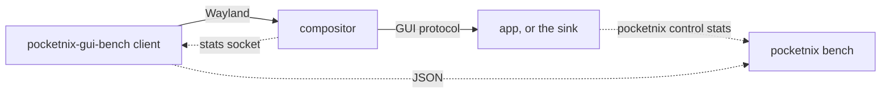
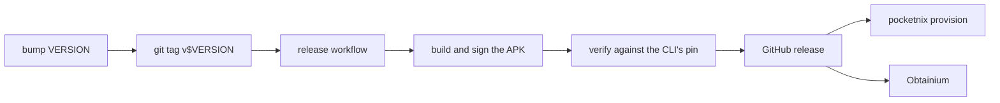

# Development

## Setup

```bash
nix develop   # the toolchains for everything below (x86_64-linux only)
```

The shell also puts this checkout's `pocketnix` on PATH, rebuilt from source
on each run.

The guest is `aarch64-linux`. On x86_64, building the example image needs
`boot.binfmt.emulatedSystems = ["aarch64-linux"]` or an aarch64 builder.
CI pushes what it builds to the `pocketnix` Cachix cache, which the flake's
`nixConfig` offers ([Getting started](getting-started.md#requirements)), so a commit CI has built downloads its aarch64 agent, kernel and
compositor instead of emulating them; a guest whose nixpkgs differs from this
flake's builds its own.

## Build

`./gradlew assembleDebug` builds `app/build/outputs/apk/debug/app-debug.apk`.
The flake's packages and apps (`nix flake show`) build the Go binaries, the
compositor and the example guest's disk image (the tests are checks of their
own, so editing one doesn't rebuild the image);
`nix run .#boot-example` boots that image under QEMU and prints the agent's
vsock address.

After changing `go/go.mod`, update `vendorHash` in `nix/go.nix`. After
changing an option or bumping `flake.lock` (nixpkgs renders the doc), run
`nix run .#options-doc` to regenerate `docs/options.md`.

## Test

```bash
nix flake check                       # every check for this system (avf-boot on x86_64 needs aarch64 builds)
(cd go && GOOS= GOARCH= go generate ./internal/portwatch)  # once per checkout: the eBPF objects
go -C go vet ./... && go -C go test ./...
nix run .#gradle -- testDebugUnitTest lintDebug
nix fmt                               # Nix, Go and Kotlin (nix/treefmt.nix)
```

The checks are `checks` in `flake.nix`; each VM test's file under `nix/`
opens with what it covers, and the NixOS VM tests run on x86_64 only.

- `nix run .#gradle` is `./gradlew` with the Android SDK and the real agent,
  compositor and foot, which the JVM integration tests opt into
  (`POCKETNIX_AGENT`, `POCKETNIX_COMPOSITOR`); plain `./gradlew` skips them.
- Lint fails on errors; `app/lint-baseline.xml` holds the warnings from
  before it ran in CI.
- A NixOS VM test runs interactively with
  `nix run .#checks.x86_64-linux.<test>.driverInteractive`.

### Booting the image without the app

The adb shell can start an AVF VM of its own with
`/apex/com.android.virt/bin/vm run`, unrooted, on a user build. Use it to
check a new phone, or a kernel or image change, without the app and without
touching the app's VM. On the Pixel 8 Pro (GrapheneOS, Android 17) the
example image boots this way to its autologin, and the console file shows
u-boot, the EFI stub, the initrd and systemd.

`vm` opens the config, the disk and the console file itself and hands
virtmgr their descriptors, so all of them can live in `/data/local/tmp`.
Push the image there in chunks (the USB trap in `AGENTS.md`), skipping the
empty ones so it stays sparse:

```bash
nix build .#example-image
img=$(echo result/*.raw) size=$(stat -L -c %s result/*.raw)
d=/data/local/tmp/pn
mib=32
adb shell mkdir -p $d
adb shell truncate -s "$size" $d/disk.img
for ((i = 0; i * (mib << 20) < size; i++)); do
  dd if="$img" of=/tmp/chunk bs=${mib}M skip=$i count=1 iflag=fullblock status=none
  cmp -s -n "$(stat -c %s /tmp/chunk)" /tmp/chunk /dev/zero && continue
  adb push -z zstd /tmp/chunk $d/chunk
  adb shell dd if=$d/chunk of=$d/disk.img bs=1M seek=$((i * mib)) conv=notrunc
done
adb shell rm $d/chunk
rm /tmp/chunk
```

Push this config as `$d/vm.json`:

```json
{
  "platform_version": "~1.0",
  "bootloader": "/apex/com.android.virt/etc/u-boot.bin",
  "disks": [{"image": "/data/local/tmp/pn/disk.img", "writable": true}],
  "memory_mib": 512
}
```

Then boot it, read the console from another terminal, and clean up:

```bash
adb shell /apex/com.android.virt/bin/vm info   # an "Available OS list" line means shell reached virtmgr
adb shell 'timeout 300 /apex/com.android.virt/bin/vm run --console /data/local/tmp/pn/console.txt /data/local/tmp/pn/vm.json < /dev/null'
adb shell cat /data/local/tmp/pn/console.txt
adb shell rm -r /data/local/tmp/pn
```

- The VM lives as long as `vm` does, so an adb drop ends it too. `timeout`
  bounds it, and `adb shell 'kill $(pidof vm)'` ends it early without
  touching the app's VM, which runs under no `vm` process.
- `vm run` ignores the JSON keys it doesn't read, and some it does read
  lose to its flags: the VM's name comes from `--name` (`vm list` shows
  `VmRun` otherwise) and its CPUs from `--cpu-topology` (one by default).
- The VM has no network, so the guest's DHCP client waits out its timeout.
- The console here is output only. With `/dev/null` on stdin, crosvm logs
  `console input thread exited with error: failed creating WaitContext:
  Operation not permitted`, and the guest boots regardless. crosvm's own log
  prints on `vm`'s output.
- Pick `memory_mib` to fit beside the app's VM when one runs (`MemAvailable`
  in `/proc/meminfo`).
- The copy takes the phone's free storage, which a running app guest counts
  as its own room, so delete it as soon as you're done.

## Run the app without a phone

Debug builds can talk to an agent over TCP instead of booting a VM, so the UI
runs on the Android emulator against a desktop agent:

```bash
nix run .#dev-agent
adb shell am start -n dev.nickolaj.pocketnix.debug/dev.nickolaj.pocketnix.ControlActivity \
  -a dev.nickolaj.pocketnix.action.START --es tcp 10.0.2.2:9100
```

`dev-agent` runs the example guest's agent config, evaluated for this
machine, with sessions as you; it never rebuilds, prunes or collects
garbage on this machine. `POCKETNIX_PORT` moves it off 9100. It listens
on loopback, which the emulator reaches as 10.0.2.2. Never listen beyond
loopback outside a test: the agent hands a shell to anyone who reaches it.

`pocketnix agent --connect <tcp:...|unix:...|vsock:<cid>:9100> <command>`
talks to an agent the way the app does (`pocketnix agent -h`).

## Scripted control

`ControlActivity` takes intents over adb (it needs the `DUMP` permission,
which the adb shell has). Send scripted actions there, never to
`MainActivity` (see `AGENTS.md`).

The actions are `dev.nickolaj.pocketnix.action.START` and `STOP`, and in debug
builds `DEBUG_LAUNCH` (launch a GUI app), `DEBUG_SETUP` (the setup form's
button) and `DEBUG_MANAGED` (Configure's and the launcher's operations on a
managed guest; `pocketnix control dump` shows their outcome). Their extras are the `EXTRA_*`
constants in `ControlActivity`; `start` reads `START`'s and gates the
debug-only ones on `BuildConfig.DEBUG`.

In debug builds, `pocketnix control` opens tabs, types into them and reads
them back (`pocketnix control -h`; `.agents/skills/pocketnix-control/SKILL.md`).

## Android's memory limit

Android 17 limits the memory of each app's process, and crosvm counts as the
app's ([the trap](../app/AGENTS.md)). `pocketnix doctor` shows a phone's limits
and where the app stands against them. To test without the limit, or until a
VM's size fits it:

```bash
pocketnix control lift-limit            # until the phone reboots
pocketnix control lift-limit --restore
```

- It lifts one uid, and needs adb after each reboot.
- The rest of the phone loses the limit's protection against this app, and
  memory pressure on the phone as a whole stays.
- The command underneath is the limiter's own test support, so an Android
  update may take it away.

## Swapping an app build

`provision` sets up a phone. To put another build of the app on a phone that
already has a VM, use `pocketnix install` (`pocketnix install -h`):

```bash
nix run .#gradle -- assembleDebug
pocketnix install --debug app/build/outputs/apk/debug/app-debug.apk
pocketnix install --debug --restore    # back to the build the phone had
```

Replacing the app kills its process, and the VM dies with it as if the power
were cut, which is why `install` stops a running VM first. The START that brings
it back carries no extras, so the settings saved in the app stay as they were.

The backup goes in Go's `os.UserCacheDir()`, under `pocketnix/backup`, by the
phone's own serial (`backupPath`), so `--restore` finds it over USB or Wi-Fi. It
also works over a build too broken to answer, unless a VM still runs for it. A
normal install refuses as soon as the app's status call fails.

When an install fails, its error says what it left behind and, if the app may
have been replaced, names the `--restore` command that undoes the swap. A build
signed with another key is refused without replacing anything, and getting past
that takes an uninstall, which deletes the VM's disk image and so everything in
the guest: `install` leaves that to you.

Android refuses `install -r -d` to downgrade an app unless the installed build
or the phone's OS is debuggable. That rules out going back from a newer release
build on a user build's phone, so such an install or `--restore` stops before
anything changes, and an install of a newer release APK warns when it closes off
`--restore`.

## Deploying a dev build to a phone guest

`pocketnix deploy` runs this checkout's agent or compositor in a phone guest
without a new system, until the guest reboots (`pocketnix deploy -h`):

```bash
pocketnix deploy agent                 # over ssh to phone-usb (pocketnix ssh-proxy -h)
pocketnix deploy --remove agent        # the system's agent again, without a reboot
pocketnix deploy compositor
pocketnix deploy --remove compositor
```

- The agent's default build is cross-compiled on x86_64, and rebuilds in
  seconds after a change. `--native` deploys the flake's own aarch64 package
  instead, which an aarch64 desktop needs. For a commit CI built it comes from
  the Cachix cache when Nix accepts the flake's config (`accept-flake-config`);
  otherwise it builds under binfmt, for minutes (the compositor's, much longer).
- The ssh user needs passwordless sudo in the guest: the copy runs the guest's
  `nix-daemon` as root and skips signature checks (the trap in `nix/AGENTS.md`),
  which grants nothing new to a user who can already be root.
- Deploy refuses a copy whose missing paths add up to more than `deployMaxCopy`:
  the copy rides adb, which drops the phone on big transfers (the root
  `AGENTS.md`'s USB trap). A guest whose system comes from another nixpkgs than
  this flake's lacks most of a native package's closure.
- The drop-ins (`pocketnix-deploy.conf`) and the deployed paths' GC roots live
  in `/run`, so a reboot clears them. `--remove` deletes them and restarts the
  unit.
- Until a reboot or `--remove`, a switch that changes the unit's ExecStart
  arguments doesn't show (the trap in `nix/AGENTS.md`).
- Restarting the agent ends the guest's open tabs and the ssh session, which
  rides the agent's port forward. Deploy reconnects, and reports success only
  once the deployed binary has stayed up for `deploySettle`. A dropped ssh isn't
  a failure until `deployReconnect` runs out.
- If the deployed agent doesn't come up, ssh goes with it, and `--remove` can't
  reach the guest either. Restart the VM from the app, or reboot from its console
  tab: the drop-in lives in `/run`, so the guest's own agent comes back.
- Only `pocketnix-agent` changes. The user units that run `pocketnix-guest`
  keep the system's package.
- [Pushing from a desktop](updates.md#pushing-from-a-desktop) has the ssh host
  this expects and the user it has to log in as.

### The compositor's library rewrite

The cross-built compositor links the cross toolchain's glibc and other libraries,
which no guest has: copied as it is, its closure is several times the
compositor's own size. So deploy rewrites its binaries to load the libraries of
the guest's system compositor, the package the unit's own ExecStart runs
(`deployRewrite`, `nix/deploy-rewrite.nix`). The result refers to no store path,
so the copy holds the compositor's own output alone, and the guest's loader
resolves each binary before the unit restarts.

When the guest has no library with a soname the cross build linked, or its
loader refuses a binary (an older glibc than the cross one, say), deploy says
why and deploys the flake's native package instead, under the same size check.
`--native` skips the rewrite.

Nix doesn't see the guest's library paths as references, so deploy also roots
the package they come from (the trap in `nix/AGENTS.md`).

The drop-in points ExecStart at the deployed package, so `pocketnix bench`
runs its `pocketnix-gui-bench` with no flag. Restarting the compositor closes
the guest's GUI windows, and restarts `pocketnix-clipboard`, which is bound to
it.

## Testing on a rented phone

[Android device streaming](https://developer.android.com/studio/run/android-device-streaming)
rents real phones by the minute, billed to a Firebase project, and the
devshell's `android` CLI reserves them. Use it to see how pocketnix does on a
phone you don't own. A person runs these steps, or an agent whose current
message from the owner says to; nothing automates a reservation. None of them
is verified on a rented phone, so read each one's output before trusting the next.

Firebase gives each project 30 free minutes a month, then charges $0.15 a
minute ([pricing](https://firebase.google.com/docs/test-lab/usage-quotas-pricing#device-streaming)).
The bill grows when a session is left running, so a run is one session, of 15
minutes by default, removed at the end even after a failure. The phone is factory
reset when a session ends, so each one starts with no app, no grants and no
disk.

### Prerequisites

These are the owner's, and no tool here sets them up:

- `android auth login`, which opens a browser. The token goes to the keyring
  through `secret-tool`, which the devshell's `android` has, or to a plain file
  with `--no-use-keyring`.
- A Firebase project with billing enabled and a budget alert.
  `android device remote projects --all` says whether a project is ready.
- The project's id, as `--project=<id>` on each `android device remote`
  command below, or once in `~/.androidrc` as `device remote --project <id>`.

`nix/android-cli.nix` packages the launcher, and says why it stays out of the
flake's checks. The launcher downloads the real CLI into `~/.android` on its
first run; `android update` updates that copy. It sends usage data to Google
unless `--no-metrics` comes first on the command line.

### Before reserving

The clock starts at `create`, and everything here is free:

```bash
nix run .#gradle -- assembleDebug   # --smoke's cleanup needs a build from this tree
pocketnix doctor --json             # the tooling works, against a phone of your own
android device remote models        # pick <codename>/<api>
gh release view "v$(cat VERSION)"   # setup fetches this release's base image
```

For a `VERSION` not released yet, serve the image first, as the end of
[Releasing from a fork](#releasing-from-a-fork) says, and add
`--es releaseUrl <url>` to step 2's `DEBUG_SETUP`.

Choose a directory for the bundles (`<dir>` below), and take your own phone off
adb, so that no command can reach its VM.

### The session

```bash
android device remote create <codename>/<api>   # prints the reservation's id and end time, then connects adb
adb devices                                     # <serial> below
```

Keep the id where you can see it. `create` takes no duration, so go by the end
time it prints. If adb loses the phone, `android device remote connect <id>`
connects it again.

Then go through these in order, cheapest finding first, and stop as soon as one
rules the phone out:

1. The probe. A `fail` verdict ends the session here:

   ```bash
   pocketnix doctor --serial <serial> --debug --record <dir>
   ```

2. The debug app, the base image and a boot. The app downloads the image
   itself, so nothing pushes gigabytes over the remote link:

   ```bash
   pkg=dev.nickolaj.pocketnix.debug
   pocketnix install --serial <serial> --debug app/build/outputs/apk/debug/app-debug.apk
   adb -s <serial> shell pm grant $pkg android.permission.POST_NOTIFICATIONS   # or the app asks, over everything else
   adb -s <serial> shell am start -n $pkg/dev.nickolaj.pocketnix.MainActivity
   adb -s <serial> shell am start -n $pkg/dev.nickolaj.pocketnix.ControlActivity -a dev.nickolaj.pocketnix.action.DEBUG_SETUP
   for try in $(seq 120); do   # 10 minutes at most: the clock is running
     dump=$(pocketnix control --serial <serial> dump --lines 1)
     echo "$dump" | head -n 1  # the state line, where phase=AgentLate shows a boot that hangs
     echo "$dump" | grep -q -e phase=Running -e phase=Failed -e phase=Refused -e setup=Failed && break
     sleep 5
   done
   ```

   Only `phase=Running` goes on to step 3. The loop ending anywhere else, or
   running out, is what this session came to find, so note it and go to the
   end of this section. A refused `pm grant` from `install` is a finding too: it
   says rented phones can't run AVF apps this way. The first connect also starts
   the guest's first rebuild, which `dump`'s `updates` lines show, and smoke's
   timings then share the phone with it.

3. The smoke check, with the phone unlocked and pocketnix in front:

   ```bash
   pocketnix doctor --serial <serial> --smoke --record <dir>
   ```

   It took about 6.5 minutes on a Pixel 8 Pro, so don't start it with less than
   that left on the clock. A locked phone gives `ok: null` for GPU and pages,
   and so does a guest with no GUI, which is how setup leaves it without
   `--es services gui`. `pocketnix doctor -h` has `--gpu-apps`, for the GPU step.

   To bring pocketnix forward, repeat the `am start` of `MainActivity`. The app
   has two launcher entries, so `resolve-activity` opens the system's chooser
   instead.

`--record` covers the doctor runs only. Setup and boot reach no video, but their
lines stay in the phone's log, and the next bundle's `logcat.txt` picks them up
from its buffers. So when a session never reaches `--smoke`, run step 1's command
once more before removing it. Recording also costs the phone memory: on one with
little free, `MemAvailable` fell to 320 MiB in a sample, so weigh that before
blaming the phone for a killed process.

Whatever happened (a failure, a dropped connection, no time left), end with:

```bash
android device remote disconnect <id>
android device remote remove <id>     # this is what stops the bill
android device remote list            # should show nothing of yours
```

If the id is gone, `android device remote list --short` prints it. Any minutes
left go back to the project.

### Going past one session

`android device remote extend --duration=<minutes> <id>` adds time, and a second
`create` starts a new session. Both need the owner's OK at that moment. A guest
with GUI on (`--es services gui`) needs a rebuild that may not fit in one
session, so ask before planning on it.

`vm run` ([Booting the image without the app](#booting-the-image-without-the-app))
stays on the Pixel: it means pushing a whole image over the remote link.

### What a Pixel 9 can and can't tell

The Pixel 9 family runs android14-6.1, like the Pixel 8 Pro. So a rented one
tests stock Android and another SoC, but can't settle `app/AGENTS.md`'s reading
that android15-6.6 and later restrict only protected VMs. That needs a Pixel 10
on 6.6, which device streaming's documentation doesn't list; `models` has what
it offers today.

### Afterwards

- Review a bundle before sharing it: it can show notifications and whatever was
  on screen, the guest's terminal included. The tooling never uploads one.
- A phone that booted can get a row in
  [Tested devices](getting-started.md#tested-devices).
- When the session was an agent's, run `android auth logout`, which also revokes
  the token. The project and its billing stay with the owner.

## Benchmarks

`pocketnix bench` measures the GUI pipeline: frame rate, latency, and what
each stage costs in CPU and bytes. Its flags and workloads are in
`pocketnix bench -h` and `pocketnix-gui-bench --help`.



- The client draws synthetic content in one window, at a cost to itself near
  zero, and times each commit to its frame callback. It snapshots the
  compositor's stats socket (`--stats-socket`) and the guest's `/proc` at
  both ends of the measured window.
- On a phone, `pocketnix bench run` starts the client in the guest over
  `--ssh` (a route like `pocketnix ssh-proxy`'s), and samples the phone over
  adb: the app's own stats, its threads, the VM's processes, SurfaceFlinger,
  CPU clocks, heat and the battery. The phone must be unlocked, with a debug
  build's VM running and GUI on; the client comes from the guest's running
  compositor's package.
- `--local` runs the desktop tier: a compositor and `pocketnix-gui-bench
  sink`, which decodes like the app and acknowledges at a display clock. It
  measures the guest's side on the desktop's CPU, without a phone. With
  `--guest-ram` the sink also stands in for guest RAM and the agent's frame
  buffers, so big frames cross as PAGES; without it they go on the stream,
  as on a guest without app-made RAM. Run both to keep both paths measured.
- `pocketnix bench report <dir> <baseline>` compares two runs' directories.

```bash
nix run .#bench -- run --ssh "ssh phone-usb" noise gradient scroll "scroll --res 0.5" rect touch
nix run .#bench -- run --local noise scroll
nix run .#bench -- run --local --guest-ram noise scroll
nix run .#bench -- run --quick --ssh "ssh phone-usb" scroll    # one short run, to iterate
```

Compare runs made in the same conditions: a warm phone throttles, and the
battery's figures are the charger's while plugged in (the report says when).
On a phone, `touch` runs tap after tap on the middle of the screen; the
report's input latencies are its.

## Permissions by hand

`provision` grants them. By hand, they are [Getting started's](getting-started.md#permissions),
for the debug build's package, `dev.nickolaj.pocketnix.debug`.

## Releasing



- `VERSION` sets the app's `versionName` and `versionCode` and the CLI's
  version. `provision` installs the release of its own version.
- The workflow refuses a tag that doesn't match `VERSION`.
- Secrets: `POCKETNIX_RELEASE_KEYSTORE` (base64 keystore),
  `POCKETNIX_RELEASE_STORE_PASSWORD`, `POCKETNIX_RELEASE_KEY_ALIAS`,
  `POCKETNIX_RELEASE_KEY_PASSWORD`.
- Keep one signing key forever. A new key forces an uninstall, which deletes
  every user's VM disk.

## Releasing from a fork

A fork signs with its own key, so `provision` needs to know it:

- `releaseCertSHA256` in `go/cmd/pocketnix/apksig.go`: the SHA-256 of your
  signing certificate (DER).
- `downloadRelease` in `go/cmd/pocketnix/provision.go`: your repo's release URL.
- Consider your own `applicationId` in `app/build.gradle.kts`, so your build
  and upstream's don't collide on a phone.

Without a release, `provision --apk <file>` installs any APK you built.

A release also publishes the base image and the package index that the app's
setup and package search download. A debug build reads them from Settings'
release files URL instead: serve `nix build .#base-image`'s image, gzipped
with its `.sha256`, and `nix run .#package-index -- <file>`, under the names
`Release.baseImage` and `Release.packageIndex` give them.

## Pitfalls

The `AGENTS.md` files list traps verified on real hardware and on the
desktop: the root's those that cross directories or come from handling a
device, and each source directory's those that bite there. Read the one for
what you change.
