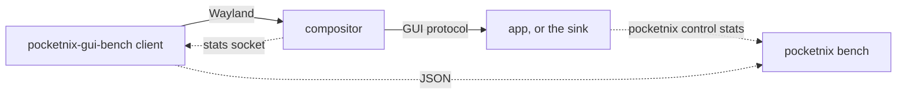
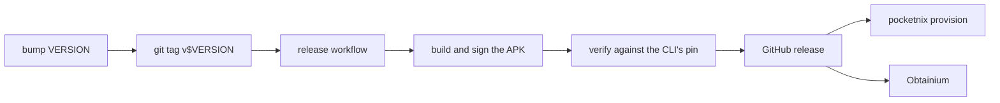

# Development

## Setup

```bash
nix develop   # the toolchains for everything below (x86_64-linux only)
```

The shell also puts this checkout's `pocketnix` on PATH, rebuilt from source
on each run.

The guest is `aarch64-linux`. On x86_64, building the example image needs
`boot.binfmt.emulatedSystems = ["aarch64-linux"]` or an aarch64 builder.
CI pushes what it builds to the `pocketnix` Cachix cache, which the flake's
`nixConfig` offers ([Getting started](getting-started.md#requirements)), so a commit CI has built downloads its aarch64 agent, kernel and
compositor instead of emulating them; a guest whose nixpkgs differs from this
flake's builds its own.

## Build

`./gradlew assembleDebug` builds `app/build/outputs/apk/debug/app-debug.apk`.
The flake's packages and apps (`nix flake show`) build the Go binaries, the
compositor and the example guest's disk image (the tests are checks of their
own, so editing one doesn't rebuild the image);
`nix run .#boot-example` boots that image under QEMU and prints the agent's
vsock address.

After changing `go/go.mod`, update `vendorHash` in `nix/go.nix`. After
changing an option or bumping `flake.lock` (nixpkgs renders the doc), run
`nix run .#options-doc` to regenerate `docs/options.md`.

## Test

```bash
nix flake check                       # every check for this system (avf-boot on x86_64 needs aarch64 builds)
(cd go && GOOS= GOARCH= go generate ./internal/portwatch)  # once per checkout: the eBPF objects
go -C go vet ./... && go -C go test ./...
nix run .#gradle -- testDebugUnitTest lintDebug
nix fmt                               # Nix, Go and Kotlin (nix/treefmt.nix)
```

The checks are `checks` in `flake.nix`; each VM test's file under `nix/`
opens with what it covers, and the NixOS VM tests run on x86_64 only.

- `nix run .#gradle` is `./gradlew` with the Android SDK and the real agent,
  compositor and foot, which the JVM integration tests opt into
  (`POCKETNIX_AGENT`, `POCKETNIX_COMPOSITOR`); plain `./gradlew` skips them.
- Lint fails on errors; `app/lint-baseline.xml` holds the warnings from
  before it ran in CI.
- A NixOS VM test runs interactively with
  `nix run .#checks.x86_64-linux.<test>.driverInteractive`.

### Booting the image without the app

The adb shell can start an AVF VM of its own with
`/apex/com.android.virt/bin/vm run`, unrooted, on a user build. Use it to
check a new phone, or a kernel or image change, without the app and without
touching the app's VM. On the Pixel 8 Pro (GrapheneOS, Android 17) the
example image boots this way to its autologin, and the console file shows
u-boot, the EFI stub, the initrd and systemd.

`vm` opens the config, the disk and the console file itself and hands
virtmgr their descriptors, so all of them can live in `/data/local/tmp`.
Push the image there in chunks (the USB trap in `AGENTS.md`), skipping the
empty ones so it stays sparse:

```bash
nix build .#example-image
img=$(echo result/*.raw) size=$(stat -L -c %s result/*.raw)
d=/data/local/tmp/pn
mib=32 # provision's chunkSize
adb shell mkdir -p $d
adb shell truncate -s "$size" $d/disk.img
for ((i = 0; i * (mib << 20) < size; i++)); do
  dd if="$img" of=/tmp/chunk bs=${mib}M skip=$i count=1 iflag=fullblock status=none
  cmp -s -n "$(stat -c %s /tmp/chunk)" /tmp/chunk /dev/zero && continue
  adb push -z zstd /tmp/chunk $d/chunk
  adb shell dd if=$d/chunk of=$d/disk.img bs=1M seek=$((i * mib)) conv=notrunc
done
adb shell rm $d/chunk
```

Push this config as `$d/vm.json`:

```json
{
  "platform_version": "~1.0",
  "bootloader": "/apex/com.android.virt/etc/u-boot.bin",
  "disks": [{"image": "/data/local/tmp/pn/disk.img", "writable": true}],
  "memory_mib": 512
}
```

Then boot it, read the console from another terminal, and clean up:

```bash
adb shell /apex/com.android.virt/bin/vm info   # an "Available OS list" line means shell reached virtmgr
adb shell 'timeout 300 /apex/com.android.virt/bin/vm run --console /data/local/tmp/pn/console.txt /data/local/tmp/pn/vm.json < /dev/null'
adb shell cat /data/local/tmp/pn/console.txt
adb shell rm -r /data/local/tmp/pn
```

- The VM lives as long as `vm` does, so an adb drop ends it too. `timeout`
  bounds it, and `adb shell 'kill $(pidof vm)'` ends it early without
  touching the app's VM, which runs under no `vm` process.
- `vm run` ignores the JSON keys it doesn't read, and some it does read
  lose to its flags: the VM's name comes from `--name` (`vm list` shows
  `VmRun` otherwise) and its CPUs from `--cpu-topology` (one by default).
- The VM has no network, so the guest's DHCP client waits out its timeout.
- The console here is output only. With `/dev/null` on stdin, crosvm logs
  `console input thread exited with error: failed creating WaitContext:
  Operation not permitted`, and the guest boots regardless. crosvm's own log
  prints on `vm`'s output.
- Pick `memory_mib` to fit beside the app's VM when one runs (`MemAvailable`
  in `/proc/meminfo`).
- The copy takes the phone's free storage, which a running app guest counts
  as its own room, so delete it as soon as you're done.

## Run the app without a phone

Debug builds can talk to an agent over TCP instead of booting a VM, so the UI
runs on the Android emulator against a desktop agent:

```bash
nix run .#dev-agent
adb shell am start -n dev.nickolaj.pocketnix.debug/dev.nickolaj.pocketnix.ControlActivity \
  -a dev.nickolaj.pocketnix.action.START --es tcp 10.0.2.2:9100
```

`dev-agent` runs the example guest's agent config, evaluated for this
machine, with sessions as you; it never rebuilds, prunes or collects
garbage on this machine. `POCKETNIX_PORT` moves it off 9100. It listens
on loopback, which the emulator reaches as 10.0.2.2. Never listen beyond
loopback outside a test: the agent hands a shell to anyone who reaches it.

`pocketnix agent --connect <tcp:...|unix:...|vsock:<cid>:9100> <command>`
talks to an agent the way the app does (`pocketnix agent -h`).

## Scripted control

`ControlActivity` takes intents over adb (it needs the `DUMP` permission,
which the adb shell has). Send scripted actions there, never to
`MainActivity` (see `AGENTS.md`).

The actions are `dev.nickolaj.pocketnix.action.START` and `STOP`, and in debug
builds `DEBUG_LAUNCH` (launch a GUI app), `DEBUG_SETUP` (the setup form's
button) and `DEBUG_MANAGED` (Configure's and the launcher's operations on a
managed guest; `pocketnix control dump` shows their outcome). Their extras are the `EXTRA_*`
constants in `ControlActivity`; `start` reads `START`'s and gates the
debug-only ones on `BuildConfig.DEBUG`.

In debug builds, `pocketnix control` opens tabs, types into them and reads
them back (`pocketnix control -h`; `.agents/skills/pocketnix-control/SKILL.md`).

## Benchmarks

`pocketnix bench` measures the GUI pipeline: frame rate, latency, and what
each stage costs in CPU and bytes. Its flags and workloads are in
`pocketnix bench -h` and `pocketnix-gui-bench --help`.



- The client draws synthetic content in one window, at a cost to itself near
  zero, and times each commit to its frame callback. It snapshots the
  compositor's stats socket (`--stats-socket`) and the guest's `/proc` at
  both ends of the measured window.
- On a phone, `pocketnix bench run` starts the client in the guest over
  `--ssh` (a route like `pocketnix ssh-proxy`'s), and samples the phone over
  adb: the app's own stats, its threads, the VM's processes, SurfaceFlinger,
  CPU clocks, heat and the battery. The phone must be unlocked, with a debug
  build's VM running and GUI on; the client comes from the guest's running
  compositor's package.
- `--local` runs the desktop tier: a compositor and `pocketnix-gui-bench
  sink`, which decodes like the app and acknowledges at a display clock. It
  measures the guest's side on the desktop's CPU, without a phone. With
  `--guest-ram` the sink also stands in for guest RAM and the agent's frame
  buffers, so big frames cross as PAGES; without it they go on the stream,
  as on a guest without app-made RAM. Run both to keep both paths measured.
- `pocketnix bench report <dir> <baseline>` compares two runs' directories.

```bash
nix run .#bench -- run --ssh "ssh phone-usb" noise gradient scroll "scroll --res 0.5" rect touch
nix run .#bench -- run --local noise scroll
nix run .#bench -- run --local --guest-ram noise scroll
nix run .#bench -- run --quick --ssh "ssh phone-usb" scroll    # one short run, to iterate
```

Compare runs made in the same conditions: a warm phone throttles, and the
battery's figures are the charger's while plugged in (the report says when).
On a phone, `touch` runs tap after tap on the middle of the screen; the
report's input latencies are its.

## Permissions by hand

`provision` grants them. By hand, they are [Getting started's](getting-started.md#permissions),
for the debug build's package, `dev.nickolaj.pocketnix.debug`.

## Releasing



- `VERSION` sets the app's `versionName` and `versionCode` and the CLI's
  version. `provision` installs the release of its own version.
- The workflow refuses a tag that doesn't match `VERSION`.
- Secrets: `POCKETNIX_RELEASE_KEYSTORE` (base64 keystore),
  `POCKETNIX_RELEASE_STORE_PASSWORD`, `POCKETNIX_RELEASE_KEY_ALIAS`,
  `POCKETNIX_RELEASE_KEY_PASSWORD`.
- Keep one signing key forever. A new key forces an uninstall, which deletes
  every user's VM disk.

## Releasing from a fork

A fork signs with its own key, so `provision` needs to know it:

- `releaseCertSHA256` in `go/cmd/pocketnix/apksig.go`: the SHA-256 of your
  signing certificate (DER).
- `downloadRelease` in `go/cmd/pocketnix/provision.go`: your repo's release URL.
- Consider your own `applicationId` in `app/build.gradle.kts`, so your build
  and upstream's don't collide on a phone.

Without a release, `provision --apk <file>` installs any APK you built.

A release also publishes the base image and the package index that the app's
setup and package search download. A debug build reads them from Settings'
release files URL instead: serve `nix build .#base-image`'s image, gzipped
with its `.sha256`, and `nix run .#package-index -- <file>`, under the names
`Release.baseImage` and `Release.packageIndex` give them.

## Pitfalls

The `AGENTS.md` files list traps verified on real hardware and on the
desktop: the root's those that cross directories or come from handling a
device, and each source directory's those that bite there. Read the one for
what you change.
