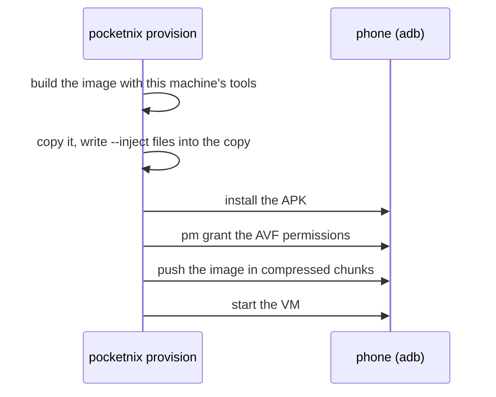

# Getting started

There are two ways in:

- **Without a NixOS flake**: install the app (from the GitHub releases, or
  through Obtainium), grant it the two AVF permissions once from a computer
  (see [Permissions](#permissions)), open it, and fill in the setup form. It
  downloads a NixOS image and configures it from the app; Configure changes
  it later. The rest of this page is for the other way.
- **Your own flake**: describe the guest in Nix and provision it from your
  computer, as below. `pocketnix provision` without `--image` does the first
  way's setup over adb instead.

## Permissions

Only the adb shell can grant them, so the app can't ask for them itself:

```bash
adb shell pm grant dev.nickolaj.pocketnix android.permission.MANAGE_VIRTUAL_MACHINE
adb shell pm grant dev.nickolaj.pocketnix android.permission.USE_CUSTOM_VIRTUAL_MACHINE
```

They last until the app is uninstalled; USB or wireless debugging can be
turned off again afterwards.

## Requirements

- A phone whose AVF runs non-protected custom VMs. Tested on a Pixel 8 Pro with
  GrapheneOS (Android 17). The app's first screen lists anything missing.
- USB debugging on the phone, and `adb` on your machine (provisioning needs it
  once).
- Nix with flakes, on a machine that can build `aarch64-linux`:
  - an aarch64 Linux machine or remote builder, or
  - x86_64 with `boot.binfmt.emulatedSystems = ["aarch64-linux"];`. Most of the
    closure comes from cache.nixos.org, and the agent, compositor and kernel
    from the pocketnix cache; without it they build under emulation.
- The pocketnix cache: the template's flake offers it, and Nix asks once to
  accept it (or pass `--accept-flake-config`). Unless you're a trusted Nix user,
  Nix uses it only if `https://pocketnix.cachix.org` is in your
  `nix.settings.trusted-substituters`; you can also add it, with the key from
  pocketnix's `flake.nix`, to `nix.settings.substituters` and
  `trusted-public-keys`. A flake whose pocketnix input `follows` its own
  nixpkgs builds the agent and compositor itself.
- Free space on the phone for the disk (`--disk`, or set in the app).

## 1. Describe the guest

Add the module to an `aarch64-linux` NixOS configuration, or start a flake
from the template:

```bash
nix flake init -t github:nickolaj-jepsen/pocketnix
```

Its [`configuration.nix`](../templates/default/configuration.nix) is a useful
start, with ssh through a port forward; rename its user and host.
[`example/configuration.nix`](../example/configuration.nix) is a fuller one,
and [Configuration](configuration.md) covers the rest.

## 2. Get the app

`provision` installs the release APK matching its own version from this
repo's GitHub releases. If its version has no release, or to run your own
build, build a debug APK and pass it in:

```bash
git clone https://github.com/nickolaj-jepsen/pocketnix && cd pocketnix
nix develop --command ./gradlew assembleDebug
# then add to provision: --debug --apk app/build/outputs/apk/debug/app-debug.apk
```

The debug app (`dev.nickolaj.pocketnix.debug`) installs next to the release
app with its own VM and disk.

## 3. Provision

With the phone on adb:

```bash
nix run github:nickolaj-jepsen/pocketnix#provision -- \
  --image .#nixosConfigurations.phone \
  --inject /etc/ssh/authorized_keys.d/alice=$HOME/.ssh/id_ed25519.pub --mode 0644
```



- `--inject <guest path>=<file>` puts secrets (ssh host keys for agenix,
  authorized keys) into the image without them entering the Nix store.
  Repeatable; `--mode` applies to the one before it.
- `--memory`, `--cpus one|all` and `--disk` set the VM's hardware, which the
  app's Settings can change later.
- An existing disk is never replaced without `--replace`, which destroys it.
- `pocketnix provision -h` lists every flag.

## 4. First boot

- The app opens the console tab and shows the boot. The first boot grows the
  root filesystem to fill the disk.
- Once the agent connects, a shell tab opens as `pocketnix.guest.user`.
- Start and stop the VM from the app, its notification, or the Quick Settings
  tile. Stop shuts the guest down cleanly.

## 5. Reach it from your desktop

Forwards listen on the phone's `127.0.0.1` (`lan = true` opens one to the
network). Over USB:

```bash
adb forward tcp:2022 tcp:2022
ssh -p 2022 alice@127.0.0.1
```

or use `pocketnix ssh-proxy --port 2022` as an ssh `ProxyCommand` (see
`pocketnix ssh-proxy -h`). A VPN in the guest, such as Tailscale, works too.

## Things to know

- Uninstalling the app, or clearing its data, deletes the VM's disk. Back up
  state you care about from inside the guest; the system itself rebuilds from
  your flake.
- The VM lives in the app's process. If the app crashes, the guest loses power.
- Only one networked VM can run on a phone at a time, across all apps.
- Don't build your own flake on the phone. Updates arrive pre-built ([Updates](updates.md)).
