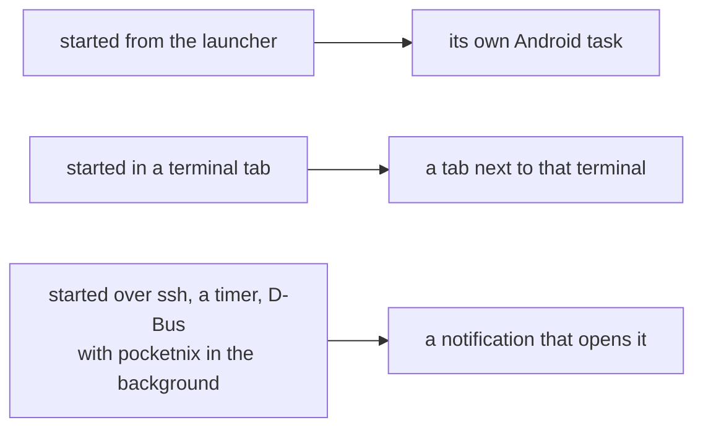

# GUI apps

Wayland apps in the guest can show as Android windows next to the terminal.
Android is the window manager: every guest window is an Android task (a
freeform window when docked) or a tab beside a terminal. There is no
pocketnix desktop.

```nix
pocketnix.guest.gui = {
  enable = true;
  defaults = {size = "phone"; input = "touch";};
  appDefaults."org.gnome.Calculator".size = "compact"; # by desktop file id
};
environment.systemPackages = [pkgs.foot pkgs.gnome-calculator];
```

`gui.enable` installs the compositor as a socket-activated user service, sets
`WAYLAND_DISPLAY` and `NIXOS_OZONE_WL=1`, and turns on PipeWire,
xdg-desktop-portal (with the FileChooser integration), an icon theme and a
small font set. CJK fonts need `fonts.enableDefaultPackages` or your own.

## Launching

- A second launcher icon, "pocketnix apps", appears once the guest has GUI on.
  It lists the `.desktop` files your system and user profiles already have.
- The list and icons are cached, so the launcher and pinned shortcuts work
  with the VM off. Tapping one boots the VM behind a splash.
- Apps can be pinned to the home screen.

## Where windows go



- A window's menu moves it between a tab and its own task.
- Dialogs draw inside their parent's window, never as Recents cards.
- Single-instance apps (Firefox, anything D-Bus-activated) open wherever their
  running process is.

## Size

- `phone` uses Android's density, `compact` about 0.75 of it, `desktop` about
  0.5.
- If a window's minimum size doesn't fit, the app lowers that window's scale,
  but not below the `desktop` factor.
- Pinch zoom magnifies and pans without changing the app's layout.
- Changes made in the window menu override the module's defaults per app,
  with a "Reset to config".

## Input

| Mode | A touch becomes |
|---|---|
| `touch` (default) | Wayland touch. Zoom is a menu toggle. |
| `pointer` | tap clicks, long press right-clicks, two-finger drag scrolls |
| `trackpad` | a relative cursor |

- Mice, touchpads and hardware keyboards go through in every mode.
- The phone keyboard opens when the app focuses a text field (text-input-v3,
  with autocorrect and voice typing). The keyboard button opens it anywhere;
  without a text field, typed text becomes key events.
- The terminal's extra keys row shows above the keyboard in windows too.
- The guest's keyboard layout follows Android's hardware keyboard layout.
- Back moves the window to the back and sends nothing to the app.

## Window controls

- A slim bar along the bottom of each window: keyboard, title, and a menu
  (size, input mode, zoom, move, close). Fullscreen apps hide it until a
  swipe up from the bottom edge.
- Docked, Android's own caption bar stays as well. Apps that accept
  server-side decorations get none drawn.

## Full desktops

sway, labwc or Plasma can run nested as an ordinary client, in one window.

## Limits

- Rendering is software in the guest: the phone's GPU is reachable from a
  VM, but nothing can composite on it yet.
- Sound plays through AVF's virtio-snd only in debug builds for now
  (`--ez audio true` on a scripted start; see [Development](development.md)).
- No X11 apps yet.
- No clipboard bridge between Wayland apps and Android yet; `pocketnix-guest
  copy` and `paste` work from a terminal.
- External displays and docked use get no special handling yet.
