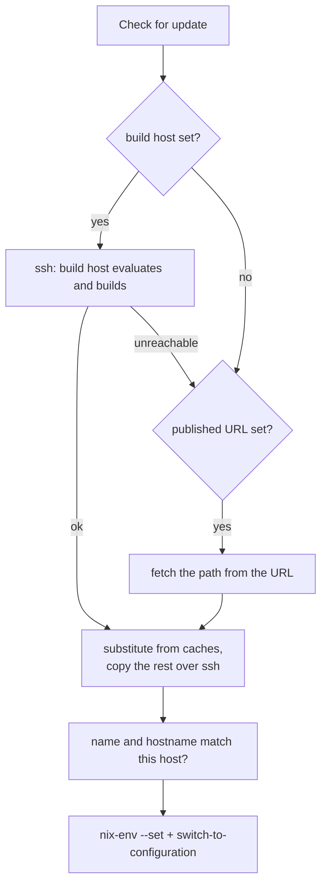

# Updates

A guest you configure in your own flake never evaluates or builds Nix on the
phone: every update arrives as a finished system path, from a build host, a
URL your CI publishes, or both. A guest the app manages is the exception: it
rebuilds its own flake (see [A managed guest](#a-managed-guest)). The app's
System menu checks, updates, rolls back and lists generations.



## Sources

```nix
pocketnix.guest.updates = {
  # Builds <flake>#nixosConfigurations.<hostName> on the build host.
  buildHost = {host = "pocketnix-build@desktop"; flake = "github:alice/nixos";};
  # Fallback: a URL whose body is the toplevel store path, in a cache the guest trusts.
  published.url = "https://ci.example.com/phone/toplevel";
  checkInterval = "6h"; # background checks only report; null disables them
};
# The agent ssh's in BatchMode with the guest's host key: the build host must be known.
programs.ssh.knownHosts.desktop.publicKey = "ssh-ed25519 ...";
```

- Build host: any machine with Nix that accepts the guest's ssh host key.
  It runs `nix build --refresh --print-out-paths <installable>`. The guest
  then substitutes what its caches have and copies only the rest from the
  build host.
- Published path: CI builds the system, pushes it to a binary cache, and
  publishes the toplevel path as one line of text at an https URL. The guest
  fetches it with `--max-jobs 0`, substituting only. No build host needs to be
  up.
- A check asks the build host first and falls back to the published path.
- An answer must be named `nixos-system-<host>-...`, and the fetched system's
  `etc/hostname` must match, before it becomes a generation.

## The build host's side

`nixosModules.buildHost` adds an untrusted user whose ssh key, per guest, can
only build that guest's system and serve the copy. A stolen phone gets no
shell on your desktop.

```nix
imports = [pocketnix.nixosModules.buildHost];
pocketnix.buildHost = {
  enable = true;
  guests.phone = {
    publicKey = "ssh-ed25519 ..."; # the guest's /etc/ssh/ssh_host_ed25519_key.pub
    installable = "github:alice/nixos#nixosConfigurations.phone.config.system.build.toplevel";
  };
};
```

Inject the guest's host key at provision time so you know its public key in
advance (see [Configuration](configuration.md#secrets)).

## Applying

- Nothing applies on its own. Background checks show "update available"; you
  tap Update.
- On a metered network the app asks first, and checks skip while the phone is
  offline.
- The switch runs in its own unit (`systemd-run`), as nixos-rebuild does, so
  closing a tab can't interrupt it. A switch reloads the agent rather than
  restarting it, so open tabs survive.
- A new agent binary takes over at the next boot. The app offers a reboot
  when the running system isn't the booted one.

## A managed guest

`nixosModules.managed` is the guest the app sets up from the release's base
image. Its system is the flake in `/etc/nixos`, seeded on first boot:

- `pocketnix.json` holds what the app's Configure screen sets (the user and
  the service switches). The app owns it and keeps a copy, and a disk that
  lacks it is rebuilt from that copy when it connects. Desktop apps is
  `pocketnix.guest.gui.enable`, so with it the guest's windows also bring
  their sound and share the clipboard ([GUI apps](gui.md)).
- `configuration.nix` is yours, for anything the switches don't cover. The
  app doesn't keep a copy, so a fresh disk starts from the seed's: back it
  up like the rest of the guest's state.
- `flake.nix` pins one pocketnix release, whose nixpkgs the guest uses, so
  the cache has what it needs. Update moves the pin to the app's own version.

A check evaluates the flake under a CPU quota
(`pocketnix.guest.managed.cpuQuota`) and plans the build: what it downloads,
and which packages it would compile because no cache has them. Update asks
before compiling anything; configuration files build without asking.

Packages added in the app go to the user's Nix profile (`nixpkgs#<attr>`,
the system's own nixpkgs), with no rebuild. Running one from the launcher
fetches it into a profile the next boot empties.

## Old generations

After each boot, and after each switch, the agent deletes the system
generations besides the running and the booted one that
`pocketnix.guest.updates.keepGenerations` doesn't keep (null keeps them all),
and collects the garbage. A managed guest sets it from the app's Configure
screen.

## Rollback

Generations come from the system profile. Rolling back switches to an older
one (`nix-env --switch-generation`, then `switch`). With `keepGenerations`
at 0, the only older one is the booted system, and once a boot of the new one
prunes, there is none.

## A generation that won't boot

- systemd-boot doesn't wait (the module's `boot.loader.timeout`).
- "Start with boot menu" in the app taps a key on the console during boot, so
  systemd-boot shows its menu in the console tab. Pick an older generation
  there: the menu lists only those pruning kept (see Old generations).
- The app offers this when the agent is late to connect.

## Pushing from a desktop

`nixos-rebuild --target-host` works as usual, over the network or over USB
with `pocketnix ssh-proxy` as the ssh `ProxyCommand`:

```
Host phone-usb
  HostKeyAlias phone
  ProxyCommand pocketnix ssh-proxy --port 2022
```

```bash
nixos-rebuild switch --flake .#phone --target-host alice@phone-usb --sudo
```
